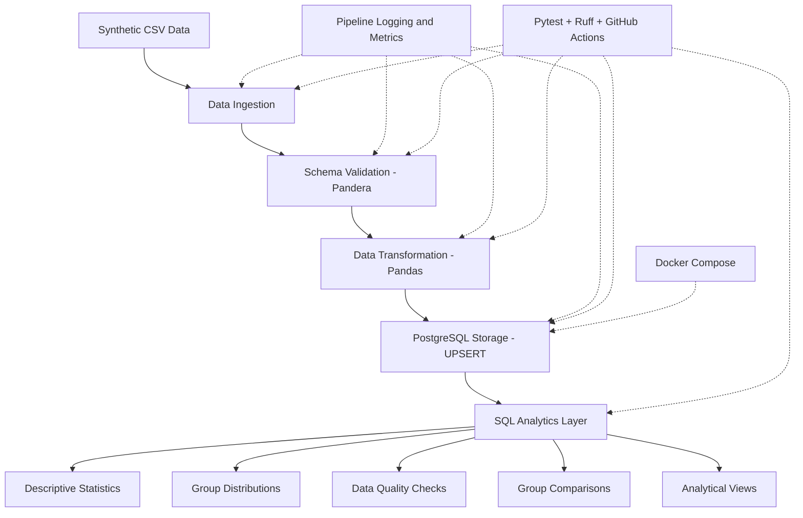

# DataForge

**A reproducible Python and SQL data engineering pipeline for ingestion, validation, transformation, PostgreSQL storage, and analytics.**

[](https://github.com/jeanmlv-dev/dataforge/actions/workflows/ci.yml)


DataForge is an end-to-end data engineering portfolio project demonstrating modular ETL architecture, schema validation, idempotent database operations, automated testing, pipeline observability, containerized execution, and SQL analytics.

The project processes synthetic patient-measurement data, transforming raw CSV records into validated, analysis-ready information stored in PostgreSQL.

It demonstrates how a reproducible data pipeline can support downstream statistical analysis, descriptive reporting, data quality assessment, and analytical applications.

> **Project status:** ETL pipeline, PostgreSQL integration, automated testing, logging, Docker containerization, and SQL analytics layer implemented. Continuous integration is configured through GitHub Actions.

## Architecture



The pipeline follows a modular Extract, Transform, Load (ETL) architecture.

1. **Extract:** Read synthetic patient-measurement data from CSV files.
2. **Validate:** Verify schema structure, required fields, data types, and allowed values.
3. **Transform:** Generate derived variables for downstream analysis.
4. **Load:** Insert or update records in PostgreSQL using idempotent UPSERT operations.
5. **Analyze:** Execute SQL queries and views for descriptive statistics, group comparisons, distributions, and data quality checks.
6. **Monitor:** Capture execution logs, processed-record counts, errors, and execution duration.

## Key Features

- **Modular ETL:** Independent modules for ingestion, validation, transformation, and persistence.
- **Schema validation:** Data quality checks implemented using Pandera.
- **Data transformation:** Derived age groups and squared measurement variables.
- **Idempotent database writes:** PostgreSQL `ON CONFLICT` operations prevent duplicate records across repeated executions.
- **Pipeline observability:** Structured execution messages, processing metrics, error reporting, and execution duration.
- **Containerized execution:** Run the ETL application and PostgreSQL using Docker Compose.
- **SQL analytics:** Descriptive statistics, age distributions, data quality checks, and group comparisons.
- **Reusable analytical views:** PostgreSQL views provide standardized access to analytical results.
- **Automated testing:** Unit, database integration, end-to-end pipeline, logging, and SQL analytics tests.
- **Continuous integration:** GitHub Actions automatically executes tests and code quality checks.
- **Reproducibility:** Dependency management through `uv`, containerized infrastructure, and synthetic sample data.

## Technology Stack

| Area | Technologies |
|---|---|
| Programming | Python 3.13, SQL |
| Data processing | Pandas |
| Data validation | Pandera |
| Database | PostgreSQL 17, Psycopg |
| Data analytics | PostgreSQL SQL, CTEs, aggregate functions, window functions, views |
| Infrastructure | Docker, Docker Compose |
| Dependency management | uv |
| Testing | Pytest |
| Code quality | Ruff |
| Observability | Python logging, pipeline execution metrics |
| CI/CD | GitHub Actions |
| Development environment | VS Code, Git, GitHub |

## Repository Structure

```text
dataforge/
├── .github/
│   └── workflows/
│       └── ci.yml
│
├── data/
│   └── sample/
│       └── example.csv
│
├── docs/
├── scripts/
│
├── sql/
│   ├── 001_create_tables.sql
│   ├── 002_descriptive_statistics.sql
│   ├── 003_group_distributions.sql
│   ├── 004_data_quality_checks.sql
│   ├── 005_group_comparisons.sql
│   ├── 006_analytics_views.sql
│   └── queries/
│
├── src/
│   └── dataforge/
│       ├── ingestion/
│       ├── validation/
│       ├── transformation/
│       ├── storage/
│       ├── observability/
│       └── pipeline.py
│
├── tests/
│   ├── unit/
│   ├── integration/
│   │   ├── test_postgres.py
│   │   ├── test_pipeline_e2e.py
│   │   └── test_sql_analytics.py
│   └── fixtures/
│
├── .dockerignore
├── .env.example
├── .gitignore
├── .python-version
├── compose.yaml
├── Dockerfile
├── pyproject.toml
├── uv.lock
└── README.md
```

## Getting Started

### Prerequisites

- Python 3.13
- [uv](https://docs.astral.sh/uv/)
- Docker Desktop with Docker Compose
- Git

### 1. Clone the repository

```bash
git clone https://github.com/jeanmlv-dev/dataforge.git
cd dataforge
```

### 2. Install Python dependencies

```bash
uv sync
```

### 3. Configure environment variables

Create a local `.env` file using the example configuration.

**Windows PowerShell:**

```powershell
Copy-Item .env.example .env
```

**Linux / macOS:**

```bash
cp .env.example .env
```

Configure the following variables:

```dotenv
POSTGRES_HOST=localhost
POSTGRES_PORT=5433
POSTGRES_DB=dataforge
POSTGRES_USER=dataforge
POSTGRES_PASSWORD=change_me
```

Replace `change_me` with a local development password before running the application.

**Security:** Never commit `.env`, database credentials, confidential information, or real patient data.

### 4. Start PostgreSQL

```bash
docker compose up -d postgres
```

Verify that PostgreSQL is healthy:

```bash
docker compose ps
```

### 5. Initialize the database schema

**Windows PowerShell:**

```powershell
Get-Content sql/001_create_tables.sql -Raw | docker compose exec -T postgres psql -U dataforge -d dataforge -v ON_ERROR_STOP=1
```

**Linux / macOS:**

```bash
docker compose exec -T postgres psql -U dataforge -d dataforge -v ON_ERROR_STOP=1 < sql/001_create_tables.sql
```

If the database schema has already been initialized, this step may be unnecessary.

### 6. Run the ETL pipeline locally

```bash
uv run python -m dataforge.pipeline --input data/sample/example.csv
```

The pipeline reads the sample CSV, validates and transforms the data, and inserts or updates the records in PostgreSQL.

### 7. Run the ETL pipeline with Docker Compose

Build the application image:

```bash
docker compose build etl
```

Execute the containerized ETL pipeline:

```bash
docker compose run --rm etl
```

This approach provides a reproducible execution environment without requiring the application to run directly on the host machine.

### 8. Inspect the stored data

```bash
docker compose exec postgres psql -U dataforge -d dataforge -c "SELECT * FROM patient_measurements ORDER BY record_id;"
```

## SQL Analytics Layer

DataForge includes a PostgreSQL analytics layer that transforms stored patient-measurement records into descriptive statistics, data quality indicators, and group-level analytical summaries.

The analytical SQL scripts are designed to demonstrate practical database analysis using SQL aggregations, Common Table Expressions (CTEs), window functions, and reusable views.

### Available SQL Scripts

| File | Analytical purpose |
|---|---|
| `002_descriptive_statistics.sql` | Calculate descriptive statistics by study group |
| `003_group_distributions.sql` | Analyze age-group distributions and percentages |
| `004_data_quality_checks.sql` | Detect duplicates, missing values, invalid ages, and inconsistent derived measurements |
| `005_group_comparisons.sql` | Compare mean measurements between study groups |
| `006_analytics_views.sql` | Create reusable PostgreSQL analytical views |

### 1. Descriptive Statistics

The descriptive statistics query summarizes patient measurements by study group.

Metrics include:

- Total number of records
- Mean, minimum, and maximum age
- Mean measurement
- Standard deviation of measurements
- Minimum and maximum measurement

**Example query:**

```sql
SELECT *
FROM vw_group_statistics
ORDER BY study_group;
```

**Example results from a local test dataset:**

| Study group | Records | Mean age | Mean measurement | SD measurement |
|---|---:|---:|---:|---:|
| A | 3 | 33.67 | 12.57 | 0.88 |
| B | 2 | 48.50 | 15.65 | 0.64 |

These results demonstrate how stored data can be summarized and compared across study groups.

### 2. Age-Group Distributions

The distribution analysis calculates the number and percentage of records in each age category.

**Example query:**

```sql
SELECT *
FROM vw_age_group_distribution
ORDER BY study_group, age_group;
```

**Example results:**

| Study group | Age group | Records | Percentage within group |
|---|---|---:|---:|
| A | 18–39 | 3 | 100.00% |
| B | 40–59 | 2 | 100.00% |

Window functions calculate group totals and percentages without requiring separate aggregation queries.

### 3. Data Quality Checks

The quality-control query evaluates the integrity of records stored in PostgreSQL.

Checks include:

- Duplicate record identifiers
- Missing required values
- Invalid patient ages
- Inconsistencies between `measurement` and `measurement_squared`

**Example query:**

```sql
SELECT *
FROM vw_data_quality;
```

**Example results:**

| Total records | Duplicate IDs | Missing values | Invalid ages | Inconsistent squared measurements | Status |
|---:|---:|---:|---:|---:|---|
| 5 | 0 | 0 | 0 | 0 | PASS |

Floating-point comparisons use numerical tolerances to avoid incorrectly flagging valid results because of floating-point precision.

### 4. Study-Group Comparisons

DataForge supports comparisons between groups A and B.

The analytical query calculates:

- Number of records in each group
- Mean measurement for each group
- Absolute difference between group means
- Percentage difference relative to group A

**Example query:**

```sql
SELECT *
FROM vw_group_comparison;
```

**Example results:**

| Group A mean | Group B mean | Absolute difference | Percentage difference |
|---:|---:|---:|---:|
| 12.57 | 15.65 | 3.08 | 24.54% |

The comparison is descriptive and does not imply statistical significance or a causal treatment effect.

### 5. Execute the SQL Analytics Scripts

**Windows PowerShell:**

```powershell
Get-Content sql/002_descriptive_statistics.sql -Raw | docker compose exec -T postgres psql -U dataforge -d dataforge -v ON_ERROR_STOP=1

Get-Content sql/003_group_distributions.sql -Raw | docker compose exec -T postgres psql -U dataforge -d dataforge -v ON_ERROR_STOP=1

Get-Content sql/004_data_quality_checks.sql -Raw | docker compose exec -T postgres psql -U dataforge -d dataforge -v ON_ERROR_STOP=1

Get-Content sql/005_group_comparisons.sql -Raw | docker compose exec -T postgres psql -U dataforge -d dataforge -v ON_ERROR_STOP=1

Get-Content sql/006_analytics_views.sql -Raw | docker compose exec -T postgres psql -U dataforge -d dataforge -v ON_ERROR_STOP=1
```

The final script creates or updates the analytical views.

### 6. Query the Analytical Views

```bash
docker compose exec postgres psql -U dataforge -d dataforge -c "SELECT * FROM vw_group_statistics;"
```

```bash
docker compose exec postgres psql -U dataforge -d dataforge -c "SELECT * FROM vw_age_group_distribution;"
```

```bash
docker compose exec postgres psql -U dataforge -d dataforge -c "SELECT * FROM vw_data_quality;"
```

```bash
docker compose exec postgres psql -U dataforge -d dataforge -c "SELECT * FROM vw_group_comparison;"
```

These analytical views provide a foundation for reporting applications and future interactive dashboards.

## Pipeline Observability

DataForge implements application logging to improve execution transparency, debugging, and operational monitoring.

The pipeline records:

- Pipeline execution start and completion
- Ingestion and validation events
- Transformation progress
- Database storage operations
- Number of records processed
- Total execution duration
- Error details when execution fails

**Example execution logs:**

```text
INFO | Starting DataForge pipeline
INFO | Ingestion completed | records_read=5
INFO | Validation completed | status=success
INFO | Transformation completed | records_output=5
INFO | Storage completed | records_processed=5
INFO | Pipeline completed | status=success | records_read=5 | records_processed=5
```

Automated tests verify successful execution logs and error reporting.

## Testing and Quality Assurance

DataForge includes automated testing across the ingestion, validation, transformation, persistence, logging, and SQL analytics components.

### Unit Tests

```bash
uv run pytest tests/unit -v
```

### Integration Tests

Start PostgreSQL before executing database integration tests.

```bash
docker compose up -d postgres
uv run pytest tests/integration -v
```

### SQL Analytics Tests

```bash
uv run pytest tests/integration/test_sql_analytics.py -v
```

The SQL analytics integration tests validate:

- Successful creation of analytical views
- Expected analytical columns
- Consistency between source records and aggregated totals
- Correct age-distribution percentages
- Group-comparison calculations

### Full Test Suite

```bash
uv run pytest tests/ -v
```

### Code Quality

```bash
uv run ruff check .
uv run ruff format --check .
```

To automatically format Python files:

```bash
uv run ruff format .
```

## Continuous Integration

DataForge uses GitHub Actions to automatically validate code changes.

The CI workflow is defined in:

```text
.github/workflows/ci.yml
```

The workflow includes:

1. Repository checkout
2. Python and dependency installation using `uv`
3. Ruff linting
4. Ruff formatting validation
5. PostgreSQL service initialization
6. Database schema creation
7. Automated unit and integration tests

**CI status:** [View workflow executions](https://github.com/jeanmlv-dev/dataforge/actions)

The workflow helps ensure that changes remain compatible with the project's testing and quality requirements.

## Data Model

The main PostgreSQL table is `patient_measurements`.

| Column | Description |
|---|---|
| `record_id` | Unique record identifier and primary key |
| `patient_age` | Patient age in years |
| `study_group` | Synthetic study-group category |
| `measurement` | Numeric measurement value |
| `age_group` | Derived age category |
| `measurement_squared` | Squared measurement value |
| `updated_at` | Timestamp of the most recent database update |

Additional database constraints are defined in `sql/001_create_tables.sql`.

All records are synthetic and intended exclusively for software development and demonstration.

## Engineering Decisions

### Modular Architecture

Data ingestion, validation, transformation, storage, and analytics are separated into independent components.

This design improves maintainability, testing, and future extensibility.

### Idempotent Database Operations

PostgreSQL `INSERT ... ON CONFLICT DO UPDATE` ensures that repeated pipeline executions update existing records instead of creating duplicates.

### Reproducible Infrastructure

Docker Compose provides a consistent execution environment for the application and database.

The project uses `uv` for Python dependency management and reproducible installation.

### Automated Data Quality

Pandera validates incoming data before persistence, while SQL quality checks verify the consistency of stored records.

This provides complementary validation at the application and database layers.

### Observability

Pipeline logging provides execution visibility and makes failures easier to investigate.

### Analytical Reusability

PostgreSQL analytical views separate reusable analytical logic from the underlying ETL implementation.

These views can support future reporting tools and dashboards.

### Automated Quality Gates

GitHub Actions runs code quality checks and automated tests, reducing the risk of regressions.

## Project Roadmap

### Completed

- [x] Modular CSV ingestion
- [x] Pandera schema validation
- [x] Data transformation and derived variables
- [x] PostgreSQL integration
- [x] Idempotent UPSERT operations
- [x] Unit and integration tests
- [x] End-to-end pipeline integration tests
- [x] GitHub Actions CI
- [x] Pipeline logging and execution metrics
- [x] Docker containerization
- [x] Docker Compose application and database orchestration
- [x] Descriptive statistics in SQL
- [x] Age-group distributions
- [x] SQL data quality checks
- [x] Study-group comparisons
- [x] Reusable PostgreSQL analytical views
- [x] SQL analytics integration tests

### Planned Improvements

- [ ] Interactive analytical dashboard using Streamlit
- [ ] Visualizations for study-group comparisons and distributions
- [ ] Dashboard indicators for data quality and pipeline execution
- [ ] Expand support for additional input formats
- [ ] Implement batch processing for larger datasets
- [ ] Add automated data quality reports
- [ ] Expand architecture and deployment documentation

## Author

**Jean Mendes**

Statistical Programming · Data Engineering · Biostatistics · Data Analytics

[GitHub](https://github.com/jeanmlv-dev) · [LinkedIn](https://www.linkedin.com/in/jean-mendes-0a455680/)

---

*DataForge is an independent portfolio project developed for educational and professional demonstration purposes. All example datasets are synthetic and do not contain confidential patient information or proprietary clinical-trial data.*
