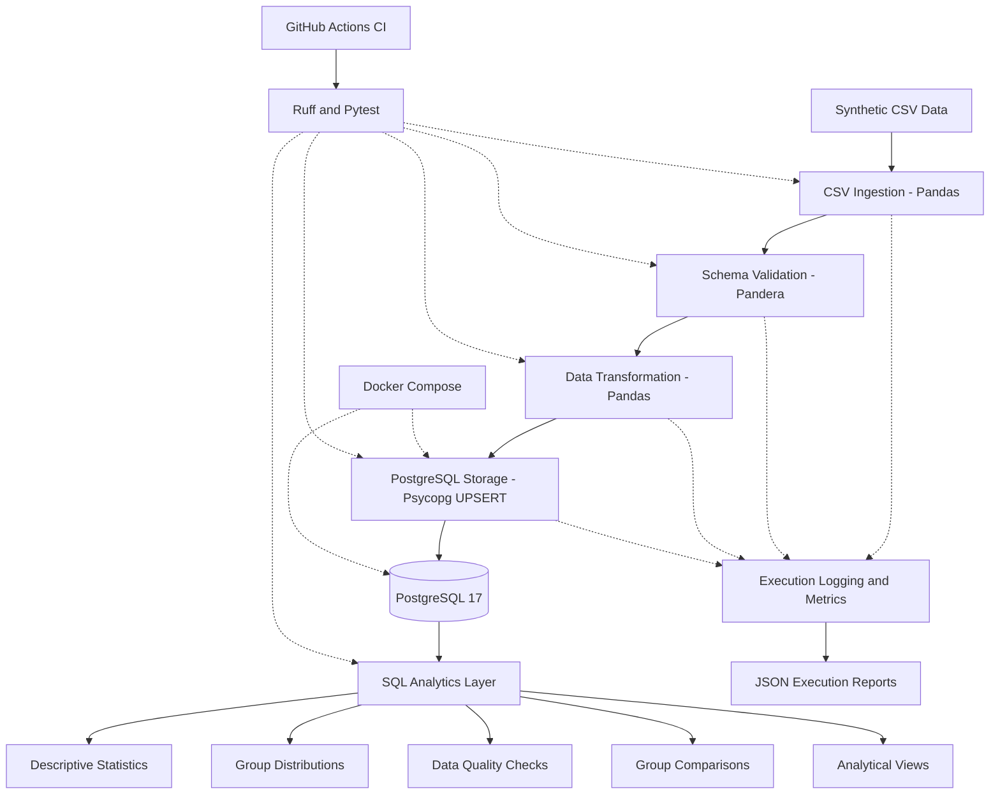
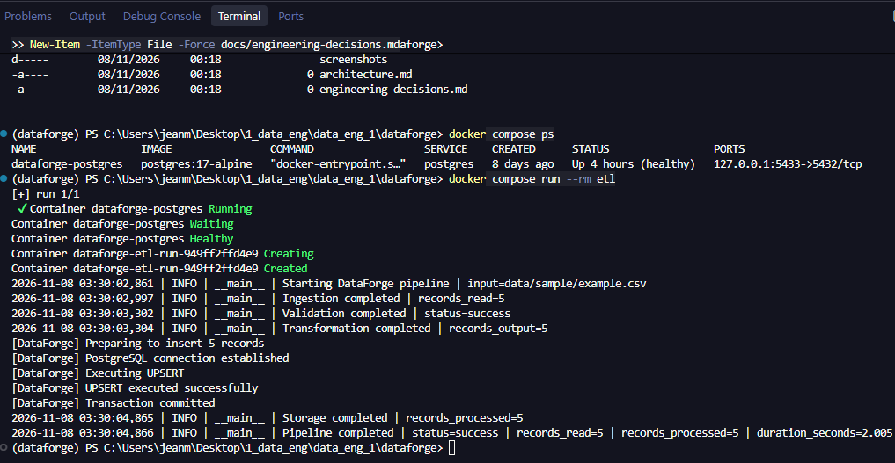
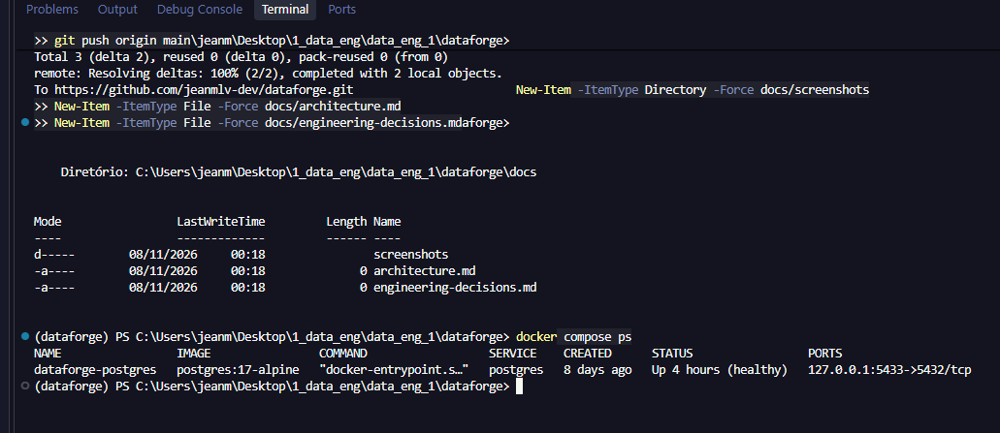
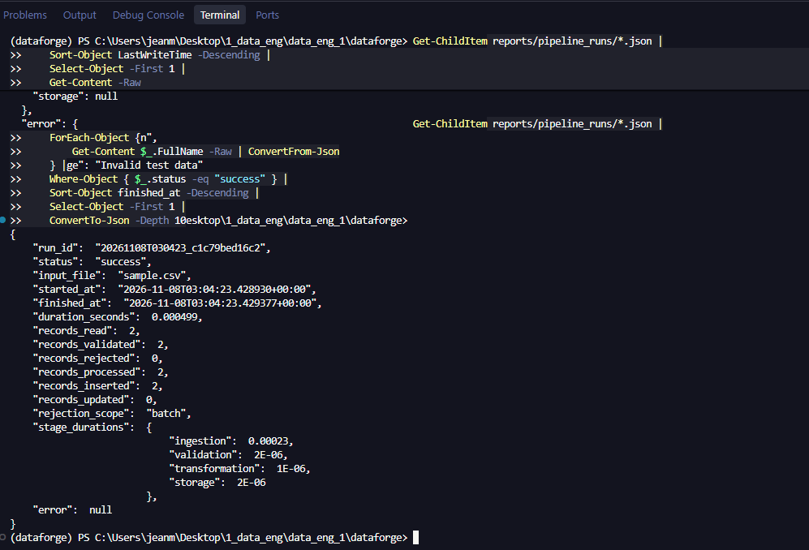

# DataForge

**A reproducible, containerized Python and SQL ETL pipeline with PostgreSQL, automated testing, observability, and an analytics layer.**

[](https://github.com/jeanmlv-dev/dataforge/actions/workflows/ci.yml)


## Overview

DataForge is an end-to-end data engineering portfolio project demonstrating how to build a reliable, reproducible, and testable ETL pipeline using Python, SQL, and PostgreSQL.

The application ingests synthetic patient-measurement data from CSV files, validates input quality, performs transformations, and persists the resulting records in a relational database.

Beyond basic ETL processing, DataForge includes:

- Idempotent PostgreSQL loading with UPSERT operations.
- Containerized execution using Docker Compose.
- Automated unit, integration, and end-to-end tests.
- GitHub Actions continuous integration.
- Structured execution logging and JSON reports.
- SQL analytics for descriptive statistics, group distributions, data quality, and group comparisons.
- Reusable PostgreSQL analytical views.

**Project scope:** Independent data engineering demonstration using synthetic data. The project does not contain real patient records or proprietary clinical-trial information.

---

## Architecture



The architecture separates data processing, persistence, analytics, and observability into independent components.

**Technical documentation:** [System Architecture](docs/architecture.md) · [Engineering Decisions](docs/engineering-decisions.md)

---

## Key Features

| Component | Implementation | Engineering Value |
|---|---|---|
| Ingestion | Python, Pandas | Structured CSV loading |
| Validation | Pandera | Schema and data-quality enforcement |
| Transformation | Pandas | Reusable feature derivation |
| Persistence | PostgreSQL, Psycopg | Transactional, idempotent UPSERT |
| Observability | Python logging, JSON | Execution metrics and error traceability |
| Analytics | PostgreSQL SQL | Aggregations, distributions, quality checks, and views |
| Containerization | Docker, Docker Compose | Reproducible application environment |
| Testing | Pytest | Unit, integration, and end-to-end verification |
| Code Quality | Ruff | Automated linting and formatting |
| Continuous Integration | GitHub Actions | Automated validation on repository changes |
| Dependency Management | uv | Locked, reproducible Python dependencies |

---

## Technology Stack

**Languages:** Python 3.13, SQL

**Data Processing:** Pandas, Pandera

**Database:** PostgreSQL 17, Psycopg

**Infrastructure:** Docker, Docker Compose

**Testing and Quality:** Pytest, Ruff

**Dependency Management:** uv

**Automation:** GitHub Actions

---

## Repository Structure

```text
dataforge/
├── .github/
│   └── workflows/
│       └── ci.yml
├── data/
│   └── sample/
│       └── example.csv
├── docs/
│   ├── screenshots/
│   │   ├── docker-compose.png
│   │   ├── execution-report.png
│   │   └── pipeline-execution.png
│   ├── architecture.md
│   └── engineering-decisions.md
├── reports/
├── scripts/
├── sql/
│   ├── 001_create_tables.sql
│   ├── 002_descriptive_statistics.sql
│   ├── 003_group_distributions.sql
│   ├── 004_data_quality_checks.sql
│   ├── 005_group_comparisons.sql
│   ├── 006_analytics_views.sql
│   └── queries/
├── src/
│   └── dataforge/
│       ├── ingestion/
│       ├── validation/
│       ├── transformation/
│       ├── storage/
│       ├── observability/
│       └── pipeline.py
├── tests/
│   ├── unit/
│   └── integration/
├── .dockerignore
├── .env.example
├── .gitignore
├── .python-version
├── Dockerfile
├── compose.yaml
├── pyproject.toml
├── uv.lock
└── README.md
```

Generated execution reports are excluded from version control.

---

## Getting Started

### Prerequisites

For the fully containerized workflow:

- Git
- Docker Desktop with Docker Compose

For local Python development:

- Python 3.13
- [uv](https://docs.astral.sh/uv/)

### 1. Clone the Repository

```bash
git clone https://github.com/jeanmlv-dev/dataforge.git
cd dataforge
```

### 2. Configure Environment Variables

Create a local environment file.

**Windows PowerShell:**

```powershell
Copy-Item .env.example .env
```

**macOS / Linux:**

```bash
cp .env.example .env
```

Update `POSTGRES_PASSWORD` in `.env` with a local development password.

The database configuration uses:

| Variable | Local default |
|---|---|
| `POSTGRES_HOST` | `localhost` |
| `POSTGRES_PORT` | `5433` |
| `POSTGRES_DB` | `dataforge` |
| `POSTGRES_USER` | `dataforge` |
| `POSTGRES_PASSWORD` | Configured in `.env` |

**Security:** Never commit `.env`, passwords, credentials, or sensitive datasets.

### 3. Start PostgreSQL

```bash
docker compose up -d postgres
```

Check the service status:

```bash
docker compose ps
```

PostgreSQL should report a healthy status before executing the pipeline.

### 4. Initialize the Database

If the schema has not already been created, initialize it using the following command.

**Windows PowerShell:**

```powershell
Get-Content sql/001_create_tables.sql -Raw |
    docker compose exec -T postgres psql -U dataforge -d dataforge -v ON_ERROR_STOP=1
```

**macOS / Linux:**

```bash
docker compose exec -T postgres psql -U dataforge -d dataforge -v ON_ERROR_STOP=1 < sql/001_create_tables.sql
```

The schema defines the `patient_measurements` table and its database constraints.

### 5. Run the Containerized ETL Pipeline

```bash
docker compose run --rm etl
```

Docker Compose starts the required services, executes the ETL pipeline, and writes the processed records into PostgreSQL.

This workflow does not require a local Python installation.

### 6. Alternative: Run with Local Python

Install the project dependencies:

```bash
uv sync
```

Execute the ETL pipeline:

```bash
uv run python -m dataforge.pipeline --input data/sample/example.csv
```

### 7. Inspect the Database

```bash
docker compose exec postgres psql -U dataforge -d dataforge -c "SELECT * FROM patient_measurements ORDER BY record_id;"
```

The query displays the persisted source and derived measurements.

---

## Execution Demonstration

The following screenshots were captured from actual local DataForge executions.

### Containerized Pipeline Execution

The ETL application runs inside a Docker container, connects to PostgreSQL, processes the sample dataset, and records execution metrics.



### Docker Compose Infrastructure

Docker Compose manages the PostgreSQL service and supports containerized ETL execution.



### Execution Observability

Each pipeline execution generates a structured JSON report with processing metrics, stage durations, execution status, and error information when applicable.



---

## Observability and Execution Metrics

DataForge provides execution-level traceability through structured logging and JSON reports.

Reports are written to:

```text
reports/pipeline_runs/
```

Each execution includes information such as:

| Metric | Description |
|---|---|
| `run_id` | Unique pipeline execution identifier |
| `status` | Execution outcome |
| `input_file` | Processed input file |
| `started_at` | Execution start timestamp |
| `finished_at` | Execution completion timestamp |
| `duration_seconds` | Total execution duration |
| `records_read` | Number of input records |
| `records_validated` | Number of validated records |
| `records_rejected` | Number of rejected records |
| `records_processed` | Number of records processed by storage |
| `records_inserted` | Number of inserted database records |
| `records_updated` | Number of updated database records |
| `stage_durations` | Execution time by processing stage |
| `error` | Error details, when applicable |

### Example: Successful Execution

```json
{
  "status": "success",
  "input_file": "data/sample/example.csv",
  "records_read": 5,
  "records_validated": 5,
  "records_rejected": 0,
  "records_processed": 5,
  "records_inserted": 0,
  "records_updated": 5,
  "rejection_scope": "batch",
  "error": null
}
```

This example illustrates a successful rerun in which all five records already exist in the database and are updated rather than duplicated.

The full execution report also contains timestamps, stage durations, and a unique run identifier.

### Example: Validation Failure

```json
{
  "status": "failed",
  "input_file": "invalid.csv",
  "records_read": 1,
  "records_validated": 0,
  "records_rejected": 1,
  "records_processed": 0,
  "records_inserted": 0,
  "records_updated": 0,
  "rejection_scope": "batch",
  "error": {
    "stage": "validation",
    "type": "ValueError",
    "message": "Invalid test data"
  }
}
```

Invalid batches are rejected before database persistence.

**Note:** The current pipeline uses batch-level rejection rather than partial acceptance of individual records.

---

## SQL Analytics Layer

DataForge includes a dedicated SQL analytics layer to demonstrate how validated and persisted data can support downstream analytical workflows.

### Analytical Components

| File | Analytical Purpose |
|---|---|
| `002_descriptive_statistics.sql` | Summary statistics by study group |
| `003_group_distributions.sql` | Age-group distributions and percentages |
| `004_data_quality_checks.sql` | Database-level integrity checks |
| `005_group_comparisons.sql` | Comparison of measurements between groups |
| `006_analytics_views.sql` | Reusable PostgreSQL analytical views |

### Create Analytical Views

**Windows PowerShell:**

```powershell
Get-Content sql/006_analytics_views.sql -Raw |
    docker compose exec -T postgres psql -U dataforge -d dataforge -v ON_ERROR_STOP=1
```

**macOS / Linux:**

```bash
docker compose exec -T postgres psql -U dataforge -d dataforge -v ON_ERROR_STOP=1 < sql/006_analytics_views.sql
```

### Query Descriptive Statistics

```sql
SELECT *
FROM vw_group_statistics;
```

### Query Age-Group Distributions

```sql
SELECT *
FROM vw_age_group_distribution;
```

### Compare Study Groups

```sql
SELECT *
FROM vw_group_comparison;
```

### Execute a SQL Analysis File

**Windows PowerShell:**

```powershell
Get-Content sql/004_data_quality_checks.sql -Raw |
    docker compose exec -T postgres psql -U dataforge -d dataforge -v ON_ERROR_STOP=1
```

### Example Analytical Results

The sample dataset contains five synthetic records distributed across two study groups.

An example of the group comparison output is:

| Metric | Group A | Group B |
|---|---:|---:|
| Record count | 3 | 2 |
| Mean measurement | 12.57 | 15.65 |

The observed difference in mean measurement is approximately **3.08**, with Group B showing a mean approximately **24.54% higher** than Group A.

These results are descriptive only. The dataset is synthetic and is not intended for clinical or causal interpretation.

---

## Automated Testing

DataForge includes unit, integration, and end-to-end tests.

The testing strategy covers:

- CSV ingestion and missing-file handling.
- Schema validation and invalid input.
- Data transformations.
- PostgreSQL persistence.
- Idempotent UPSERT behavior.
- Full ETL pipeline execution.
- Structured logging and execution metrics.
- SQL analytics views and data-quality calculations.

### Run All Tests

Ensure PostgreSQL is running, then execute:

```bash
uv run pytest tests/ -v
```

### Run Unit Tests

```bash
uv run pytest tests/unit/ -v
```

### Run Integration Tests

```bash
uv run pytest tests/integration/ -v
```

### Run Code Quality Checks

```bash
uv run ruff check .
uv run ruff format --check .
```

---

## Continuous Integration

DataForge uses GitHub Actions for automated quality verification.

The workflow is defined in:

```text
.github/workflows/ci.yml
```

It runs on pushes and pull requests targeting the configured main branch and includes:

1. Source checkout.
2. Python and dependency setup with `uv`.
3. Ruff linting.
4. Ruff formatting verification.
5. PostgreSQL service initialization.
6. Automated Pytest execution, including database integration tests.

The workflow runs on GitHub-hosted infrastructure independently of the developer's local machine.

**[View GitHub Actions workflow](https://github.com/jeanmlv-dev/dataforge/actions/workflows/ci.yml)**

---

## Engineering Decisions

DataForge follows several engineering principles.

### Idempotency

The storage layer uses PostgreSQL `ON CONFLICT` operations to prevent duplicate primary keys during repeated execution.

### Separation of Concerns

Ingestion, validation, transformation, persistence, and observability are organized into separate modules.

### Data Integrity

Schema validation and database constraints protect stored data from invalid inputs.

### Transactional Persistence

Database operations are executed within transactions to support atomic persistence.

### Reproducibility

Docker Compose and `uv.lock` provide consistent execution environments.

### Observability

Each execution produces logs and a structured report with processing metrics and failure details.

### Automated Verification

Pytest and Ruff provide repeatable quality checks, while GitHub Actions validates repository changes.

For a detailed discussion of design rationale, limitations, and trade-offs, see [Engineering Decisions](docs/engineering-decisions.md).

---

## Known Limitations

DataForge is a portfolio-scale engineering project rather than a production clinical data platform.

Current limitations include:

- CSV-focused ingestion.
- In-memory processing with Pandas.
- Small synthetic demonstration datasets.
- Batch-level validation and rejection.
- Locally stored JSON execution reports.
- No built-in workflow scheduler.
- No historical versioning of updated records.
- No production-grade high availability or disaster recovery.

These limitations define the scope of the initial release and provide opportunities for future enhancements.

---

## Project Roadmap

### Version 1.0.0

- [x] Python CSV ingestion.
- [x] Pandera data validation.
- [x] Pandas transformations.
- [x] PostgreSQL persistence.
- [x] Idempotent UPSERT operations.
- [x] Automated unit tests.
- [x] PostgreSQL integration tests.
- [x] End-to-end ETL tests.
- [x] GitHub Actions CI.
- [x] Structured pipeline logging.
- [x] JSON execution reports.
- [x] Dockerized Python ETL application.
- [x] Docker Compose infrastructure.
- [x] SQL analytics queries and views.
- [x] SQL integration tests.
- [x] Architecture documentation.
- [x] Engineering decisions documentation.
- [x] Real execution screenshots.

### Potential Future Enhancements

- [ ] Support additional input formats, including Parquet.
- [ ] Add incremental ingestion and batch processing.
- [ ] Implement row-level data quarantine.
- [ ] Introduce workflow scheduling.
- [ ] Integrate centralized observability.
- [ ] Add performance benchmarks.
- [ ] Develop an interactive analytics dashboard.
- [ ] Introduce database migration management.

---

## Documentation

- [System Architecture](docs/architecture.md)
- [Engineering Decisions](docs/engineering-decisions.md)
- [GitHub Actions](https://github.com/jeanmlv-dev/dataforge/actions)

---

## Author

**Jean Mendes**

Statistical Programming · Data Science · Data Analytics & Engineering · Machine Learning

[GitHub](https://github.com/jeanmlv-dev) · [LinkedIn](https://www.linkedin.com/in/jean-mendes-0a455680/)

---

*DataForge is an independent portfolio project built for educational and professional demonstration purposes. All example data is synthetic and does not represent real patients or confidential clinical-trial records.*
