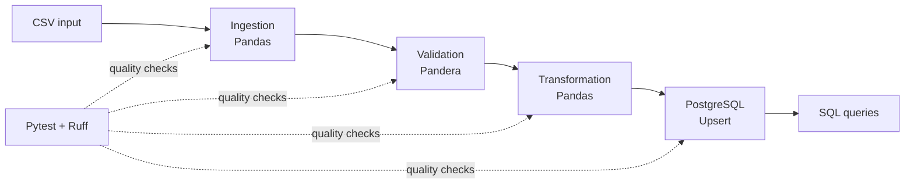

# DataForge

**A reproducible Python and SQL data pipeline for ingestion, validation, transformation, and PostgreSQL storage.**

DataForge is a portfolio project demonstrating practical data engineering patterns: modular ETL, schema validation, idempotent database writes, automated testing, and containerized infrastructure. It processes a sample patient-measurement dataset using synthetic example data.

> **Project status:** Core ETL pipeline and PostgreSQL integration implemented. Automated checks are configured in GitHub Actions; see the Actions tab for current run results.

## Architecture



The pipeline reads a CSV file, validates its structure and values, derives analysis-ready fields, and loads records into PostgreSQL. Writes use `ON CONFLICT (record_id) DO UPDATE` so rerunning the pipeline updates existing records instead of creating duplicates.

## Key features

- **CSV ingestion:** Load input files into Pandas DataFrames with explicit handling of missing or empty files.
- **Data validation:** Check required columns, data types, permitted study groups, and value constraints using Pandera.
- **Transformation:** Derive age groups and squared measurement values while preserving input data.
- **PostgreSQL storage:** Perform parameterized, idempotent upserts with Psycopg.
- **Reproducible environment:** Run PostgreSQL through Docker Compose and manage Python dependencies with `uv`.
- **Quality assurance:** Run unit and database integration tests with Pytest, and lint/format with Ruff.
- **Continuous integration:** GitHub Actions workflow located at `.github/workflows/ci.yml`.

## Tech stack

| Area | Technologies |
| --- | --- |
| Programming | Python, SQL |
| Data processing | Pandas |
| Data validation | Pandera |
| Database | PostgreSQL, Psycopg |
| Infrastructure | Docker, Docker Compose |
| Dependency management | uv |
| Testing and quality | Pytest, Ruff |
| CI | GitHub Actions |

## Repository structure

```text
dataforge/
├── .github/workflows/ci.yml
├── data/sample/example.csv
├── docs/
├── scripts/
├── sql/
│   ├── 001_create_tables.sql
│   └── queries/
├── src/dataforge/
│   ├── ingestion/csv_reader.py
│   ├── validation/schemas.py
│   ├── transformation/cleaning.py
│   ├── storage/postgres.py
│   ├── observability/
│   └── pipeline.py
├── tests/
│   ├── unit/
│   └── integration/test_postgres.py
├── .env.example
├── compose.yaml
├── pyproject.toml
└── README.md
```

## Getting started

### Prerequisites

- Python compatible with the version specified in `.python-version`
- [uv](https://docs.astral.sh/uv/)
- Docker Desktop with Docker Compose

### 1. Clone and install

```bash
git clone https://github.com/jeanmendes-dev/dataforge.git
cd dataforge
uv sync
```

### 2. Configure the environment

Copy the example configuration into a local `.env` file:

**PowerShell (Windows):**

```powershell
Copy-Item .env.example .env
```

**macOS / Linux:**

```bash
cp .env.example .env
```

Update `POSTGRES_PASSWORD` in `.env` with your own local development password. The application uses `POSTGRES_HOST=localhost`, `POSTGRES_PORT=5433`, `POSTGRES_DB=dataforge`, and `POSTGRES_USER=dataforge` by default.

**Security:** Never commit `.env`, credentials, patient information, or proprietary datasets. The repository's sample data should remain synthetic.

### 3. Start PostgreSQL

```bash
docker compose up -d
```

Check that the database container is running:

```bash
docker compose ps
```

If the database schema has not yet been initialized, apply the SQL migration:

```bash
docker compose exec -T postgres psql -U dataforge -d dataforge < sql/001_create_tables.sql
```

> **Windows PowerShell note:** Input redirection with `<` is not supported in all PowerShell versions. Use the following instead:
>
> ```powershell
> Get-Content sql/001_create_tables.sql -Raw | docker compose exec -T postgres psql -U dataforge -d dataforge
> ```
>
> If the Compose configuration already initializes the schema, you can skip this step.

### 4. Run the ETL pipeline

```bash
uv run python -m dataforge.pipeline --input data/sample/example.csv
```

The pipeline reads the sample CSV, validates and transforms records, then inserts or updates them in PostgreSQL.

### 5. Inspect the stored data

```bash
docker compose exec postgres psql -U dataforge -d dataforge -c "SELECT * FROM patient_measurements ORDER BY record_id;"
```

## Testing and code quality

Run the unit tests:

```bash
uv run pytest tests/unit -v
```

Run database integration tests **while PostgreSQL is running**:

```bash
uv run pytest tests/integration -v
```

Run all tests:

```bash
uv run pytest tests/ -v
```

Check code quality:

```bash
uv run ruff check .
uv run ruff format --check .
```

To automatically format files locally:

```bash
uv run ruff format .
```

## Data model

The PostgreSQL table `patient_measurements` includes:

| Column | Purpose |
| --- | --- |
| `record_id` | Unique record identifier; primary key for upserts |
| `patient_age` | Input age |
| `study_group` | Study-group category |
| `measurement` | Input measurement |
| `age_group` | Derived age band |
| `measurement_squared` | Derived squared measurement |
| `updated_at` | Database update timestamp |

The database enforces additional constraints defined in `sql/001_create_tables.sql`.

## Engineering decisions

**Idempotent loading.** A repeated run should not duplicate records because the loader uses the `record_id` primary key and PostgreSQL's `ON CONFLICT` behavior.

**Separation of concerns.** Ingestion, validation, transformation, and persistence live in separate modules so each stage can be tested independently.

**Automated checks.** Unit tests verify expected transformations and validation failures. Integration tests exercise actual PostgreSQL writes and repeated upserts.

**Configuration outside source code.** Local database settings are read from environment variables rather than embedded credentials.

## Roadmap

- [x] CSV ingestion and data validation
- [x] Data transformation
- [x] PostgreSQL integration and idempotent upserts
- [x] Unit and integration tests
- [x] GitHub Actions workflow configuration
- [ ] Add structured pipeline metrics and execution summaries
- [ ] Expand input formats and batch processing
- [ ] Add richer documentation and architecture diagrams

## Author

**Jean Mendes** — Statistical Programming · Data Engineering · Biostatistics

[GitHub](https://github.com/jeanmendes-dev) · [LinkedIn](https://www.linkedin.com/in/jean-mendes-0a455680/)

---

*DataForge is an independent portfolio project. All example datasets should be synthetic and must not contain confidential clinical-trial information.*
