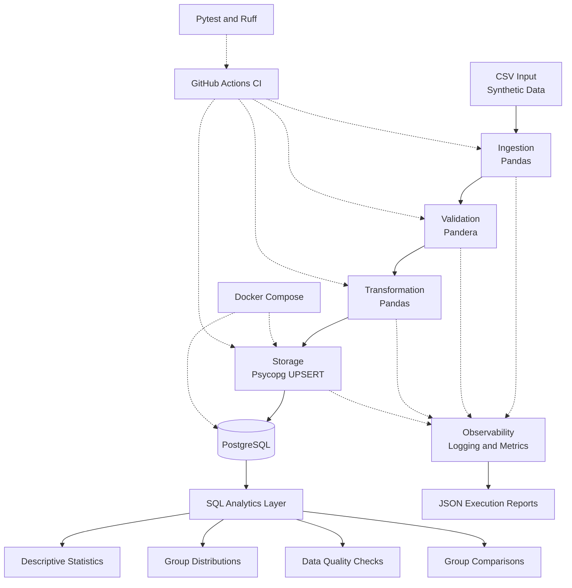

# DataForge — System Architecture

## 1. Overview

DataForge is a reproducible Python and SQL data engineering project designed to demonstrate a complete Extract, Transform, Load (ETL) workflow.

The system ingests synthetic patient-measurement data from CSV files, validates data quality, applies transformations, and persists the resulting records in PostgreSQL.

An additional SQL analytics layer provides descriptive statistics, group distributions, data quality checks, and comparative analyses.

The project emphasizes modularity, reproducibility, observability, automated testing, and containerized execution.

## 2. Architecture Diagram



The diagram illustrates the logical data flow, supporting infrastructure, analytics capabilities, and quality assurance processes.

## 3. Core Components

### 3.1 Data Ingestion

**Module:** `src/dataforge/ingestion/csv_reader.py`

The ingestion layer reads CSV files and converts them into Pandas DataFrames.

Responsibilities include:

- Reading structured input files.
- Handling missing or invalid file paths.
- Detecting empty datasets.
- Providing data to the validation layer.

**Input:** CSV file.

**Output:** Pandas DataFrame.

### 3.2 Data Validation

**Module:** `src/dataforge/validation/schemas.py`

The validation layer uses Pandera to enforce expected data structures and constraints.

Validation includes:

- Required column checks.
- Data type validation.
- Accepted study-group categories.
- Numeric value constraints.
- Rejection of invalid input data.

Validation failures prevent invalid batches from proceeding to storage.

### 3.3 Data Transformation

**Module:** `src/dataforge/transformation/cleaning.py`

The transformation layer prepares validated data for PostgreSQL storage.

Derived variables include:

| Variable | Description |
|---|---|
| `age_group` | Age category derived from `patient_age` |
| `measurement_squared` | Squared value of `measurement` |

Transformations preserve the original measurement variables while adding derived analytical fields.

### 3.4 PostgreSQL Storage

**Module:** `src/dataforge/storage/postgres.py`

DataForge uses Psycopg to communicate with PostgreSQL.

The storage layer implements parameterized SQL statements and transactional database operations.

Records are identified by the `record_id` primary key.

An UPSERT operation uses:

```sql
INSERT INTO patient_measurements (...)
VALUES (...)
ON CONFLICT (record_id)
DO UPDATE SET ...;
```

This design supports idempotent loading: rerunning the same dataset does not create duplicate records.

The enhanced storage implementation also tracks inserted and updated record counts.

### 3.5 Pipeline Orchestration

**Module:** `src/dataforge/pipeline.py`

The orchestration module coordinates the execution of the ETL stages.

Execution sequence:

1. Initialize the pipeline run and execution metadata.
2. Read the input CSV file.
3. Validate the dataset.
4. Transform validated records.
5. Insert or update records in PostgreSQL.
6. Record execution metrics.
7. Generate an execution report.

If an exception occurs, the pipeline records the failure and propagates the error.

## 4. Database Architecture

### Primary Table

`patient_measurements`

| Column | Description |
|---|---|
| `record_id` | Unique record identifier |
| `patient_age` | Patient age |
| `study_group` | Study-group classification |
| `measurement` | Original numeric measurement |
| `age_group` | Derived age category |
| `measurement_squared` | Derived squared measurement |
| `updated_at` | Database update timestamp |

The database schema is defined in:

`sql/001_create_tables.sql`

Database constraints complement application-level validation.

## 5. SQL Analytics Layer

The SQL analytics layer transforms stored records into reusable analytical outputs.

| SQL file | Purpose |
|---|---|
| `002_descriptive_statistics.sql` | Aggregated descriptive statistics |
| `003_group_distributions.sql` | Age-group distributions |
| `004_data_quality_checks.sql` | Database-level quality verification |
| `005_group_comparisons.sql` | Comparisons between study groups |
| `006_analytics_views.sql` | Reusable analytical views |

The analytics layer demonstrates that the ETL output is suitable for downstream reporting and analysis.

The SQL scripts use PostgreSQL aggregation functions, common table expressions, window functions, and views.

The project also includes integration tests to verify analytical outputs against the underlying source data.

## 6. Observability and Execution Reports

DataForge records operational metrics for each pipeline execution.

### Execution Metrics

| Metric | Description |
|---|---|
| `run_id` | Unique execution identifier |
| `status` | Execution outcome |
| `records_read` | Number of input records |
| `records_validated` | Number of validated records |
| `records_rejected` | Number of rejected records |
| `records_processed` | Number of records processed by storage |
| `records_inserted` | Number of newly inserted records |
| `records_updated` | Number of existing records updated |
| `duration_seconds` | Total execution duration |
| `stage_durations` | Execution time by pipeline stage |
| `error` | Error details when execution fails |

Execution reports are written as JSON files under:

`reports/pipeline_runs/`

These reports are runtime artifacts and are excluded from version control.

For the current implementation, validation is batch-oriented. A failed validation can reject the entire input batch rather than selectively removing individual rows.

### Execution Report Example

```json
{
  "status": "success",
  "records_read": 5,
  "records_validated": 5,
  "records_rejected": 0,
  "records_processed": 5,
  "records_inserted": 0,
  "records_updated": 5,
  "error": null
}
```

This example illustrates an idempotent rerun in which five existing records are updated.

## 7. Containerization

DataForge uses Docker Compose to provide a reproducible runtime environment.

### PostgreSQL Container

The database runs using the PostgreSQL 17 Alpine image.

Its configuration includes:

- Persistent Docker volume.
- Database health check.
- Environment-based credentials.
- Local development port mapping.

### ETL Container

The ETL application uses a Python 3.13-based Docker image.

The Dockerfile installs application dependencies using `uv` and includes the pipeline source code and sample dataset.

Docker Compose coordinates the ETL application and PostgreSQL service.

### Example Execution

```bash
docker compose up -d postgres
docker compose run --rm etl
```

The ETL service waits for the database service to become healthy before execution.

This enables the pipeline to run without requiring a local Python installation.

## 8. Automated Testing

DataForge includes multiple levels of automated testing.

| Test category | Purpose |
|---|---|
| Unit tests | Verify ingestion, validation, and transformation logic |
| Integration tests | Verify PostgreSQL operations and SQL analytics |
| End-to-end tests | Verify the complete ETL pipeline |
| Logging tests | Verify execution logs and failure handling |

The tests are implemented using Pytest.

Ruff provides static code checks and formatting validation.

### Local Verification

```bash
uv run ruff check .
uv run ruff format --check .
uv run pytest tests/ -v
```

## 9. Continuous Integration

**Workflow:** `.github/workflows/ci.yml`

GitHub Actions executes automated checks on supported push and pull-request events.

The workflow provisions PostgreSQL as a service and runs the project's quality and test checks.

This provides an independent verification environment rather than relying exclusively on the developer's local machine.

The GitHub Actions page is the authoritative source for the latest workflow status.

## 10. Security and Reproducibility

The project follows basic security and reproducibility practices:

- Credentials are supplied through environment variables.
- Local `.env` files are excluded from version control.
- Example datasets are synthetic.
- Database operations use parameterized SQL.
- Dependencies are managed through `uv`.
- Docker images provide consistent runtime environments.
- Generated execution reports are excluded from Git.
- Automated tests verify critical pipeline behavior.

DataForge is an independent portfolio project and does not use confidential clinical-trial data.

## 11. Architecture Scope and Limitations

DataForge is designed as a demonstration of practical data engineering patterns rather than a production-scale clinical data platform.

Current limitations include:

- CSV-based ingestion.
- A single primary analytical table.
- Batch-oriented validation.
- A relatively small synthetic example dataset.
- No distributed processing engine.
- No external orchestration platform.
- No dedicated data warehouse or BI application.

Potential future extensions include incremental ingestion, additional input formats, orchestration, monitoring dashboards, and more advanced analytical data models.

## 12. Related Documentation

- [Project README](../README.md)
- [Engineering Decisions](engineering-decisions.md)
- [Execution Screenshots](screenshots/)

---

**DataForge v1.0.0 — Reproducible ETL, PostgreSQL Analytics, and Automated Quality Assurance.**